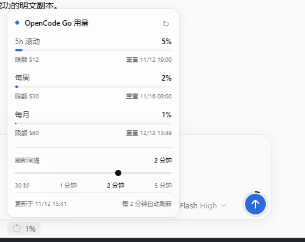

# dsh-opencode-go-usage

> **本项目基于 [Tsunamistr/dsh-opencode-go-usage](https://github.com/Tsunamistr/dsh-opencode-go-usage)
> （其上游为 [yumusb/dsh-opencode-go-usage](https://github.com/yumusb/dsh-opencode-go-usage)）
> 改造而来：为适配 DSH 0.2.2-rc.1 的插件规范做了必要修改，并重做了界面与交互。
> 与上游的具体差异见 [与上游的差异](#与上游的差异)。**

在 DSH（DeepSeek Harness）Web 界面的输入栏里显示 **OpenCode GO** 订阅用量：

- 输入栏下方、DSH 自带「上下文用量环」右侧，多一个同款小环，显示**每月总用量**；
- 发送按钮外圈有一个进度环，显示 **5 小时滚动窗口**用量；
- 点击底部小环，弹出临时用量面板（三个窗口 + 限额 + 重置时间 + 刷新间隔）。



## 功能

| 位置 | 内容 |
| --- | --- |
| 底部用量环 | 每月用量百分比，与 DSH 上下文用量环同样式（14px 环、2px 描边、悬停高亮），通过 rAF 跟随上下文环定位，始终在其右侧 12px |
| 发送按钮外圈环 | 5 小时滚动用量，纯展示：`pointer-events: none`，完全不影响输入与发送 |
| 用量面板 | 点击底部环向上弹出：5h / 每周 / 每月三条进度、限额、重置时间、更新时间；点面板外或按 `Esc` 关闭 |
| 刷新间隔 | 面板底部滑杆，四档固定刻度 **30 秒 / 1 分钟 / 2 分钟 / 5 分钟**（默认 2 分钟），选择写入 `localStorage`，拖动后立即生效 |
| 数据来源 | 宿主同源路由 `GET /opencode-go-usage/status`；API Key 只在宿主进程使用，不会下发到浏览器 |

## 安装

要求 DSH `0.1.7+`（在 **0.2.2-rc.1** 上实测）。插件是「宿主 + 浏览器」双半包。

```bash
# 1. 把仓库放到一个稳定目录（profile 以 link 方式安装，目录不能删/移）
git clone https://github.com/lx000166/dsh-opencode-go-usage.git
cd dsh-opencode-go-usage

# 2. 装进目标 profile（会同时写入依赖与 dsh.profile.bundles）
dsh plugin --profile desktop add "$(pwd)"
```

如果 `dsh plugin add` 之后 `dsh.profile.bundles` 里没有出现 `dsh-opencode-go-usage`
（依赖已存在时 CLI 不会重复追加），手工在 profile 的 `package.json` 末尾补一项：

```json
"dsh": { "profile": { "bundles": [ "...", "dsh-opencode-go-usage" ] } }
```

### 配置 API Key

插件按以下顺序取 Key：

1. DSH 凭据服务里的 `OPENCODE_GO_API_KEY`（`~/.dsh/.credentials.yaml` 或环境变量）；
2. OpenCode 自己的 `~/.local/share/opencode/auth.json`（`opencode-go` / `opencode` 的 api key）。

没有 Key 时面板会提示 `未找到 OPENCODE_GO_API_KEY 或 OpenCode auth.json`，不会影响 DSH 启动。

### 生效

宿主动了一半热加载即可生效（`/opencode-go-usage/status` 可访问即正常）；
浏览器端首次安装或修改后刷新一次页面（`Ctrl+R`，必要时 `Ctrl+Shift+R`）即可看到两个环。

## 与上游的差异

本次改造为适配 DSH 0.2.2-rc.1 做了以下修改：

| 类别 | 改动 |
| --- | --- |
| **包结构（必需）** | 新增 `cordis.patch.yml`，并在 `package.json` 声明 `dsh.bundle.patch`。0.2.x 的 profile 组合要求每个 bundle 声明 patch，否则启动时会被静默跳过（stderr: `declares no dsh.bundle`），插件根本不加载 |
| **版本门禁** | 新增 `peerDependencies: { "@deepseek-ai/dsh": ">=0.1.7-rc.1 <0.3.0" }`，0.2.0+ 会按此做硬门禁 |
| **客户端声明** | `dsh.client.inject` 去掉了 0.2.2 已不存在的 `@deepseek-ai/dsh-client-runtime`，只保留 `@deepseek-ai/dsh-client-locale` |
| **宿主路由** | `ctx.webServer.register` 包进 `ctx.effect`，禁用/重载/卸载时自动回收，避免残留 502 路由与二次启用时的 `duplicate exact route` |
| **界面重做** | 移除原来的右下角常驻卡片与「收起 / 展开」交互；改为底部 dock 月用量环 + 发送按钮 5h 环（两者分工，互不冲突） |
| **面板** | 由常驻改为点击底部环临时弹出，复用 DSH 自带 `@deepseek-ai/dsh-client-ui-primitives` 的 `Tooltip` / `useAnchoredPosition` / `useDismissOnOutsidePointer`，样式与 DSH 自带上下文面板一致 |
| **轮询** | 固定 30 秒改为可调（30s / 1m / 2m / 5m，默认 2 分钟），面板底部滑杆选择，`localStorage` 记忆 |
| **清理** | 删除无引用的 `typert.host.js`（`exports` 未声明 `./typert`，且引用了未声明的 `zod`） |

另：DSH 在**点击发送的瞬间**会同时渲染「发送中的主按钮」和原生「停止按钮」（两个 34px 圆钮），
这是 DSH 自身行为，与本插件无关；本插件的发送环只跟随发送按钮。

## 开发说明

- 浏览器半 `client.js` 是手写的 `window.__ModuleLoader__.load({ id, factory })` 包，
  `id` 必须等于包名 `dsh-opencode-go-usage`；只从模块表 require `react` / `react-dom` /
  `@deepseek-ai/dsh-client-ui-primitives` 等种子模块。
- 宿主半 `index.js` 是普通 cordis 插件：`export name / inject / apply`，
  注册同源路由并缓存上游响应。
- 改 `client.js` 后刷新页面即可（DSH `client-hmr` 会重组 bundle）；改 `index.js` 需要重启 `dsh web` 或桌面端。

## 兼容性

- 实测：DSH **0.2.2-rc.1**（桌面打包版，`desktop` profile）
- 声明范围：`>=0.1.7-rc.1 <0.3.0`（0.2.x 全系）
- 平台：Web（`dsh.client.platform: "web"`）

## 上游与许可

- 上游：[Tsunamistr/dsh-opencode-go-usage](https://github.com/Tsunamistr/dsh-opencode-go-usage)（再上游：[yumusb/dsh-opencode-go-usage](https://github.com/yumusb/dsh-opencode-go-usage)）
- 许可见 [LICENSE](LICENSE)（MIT）
